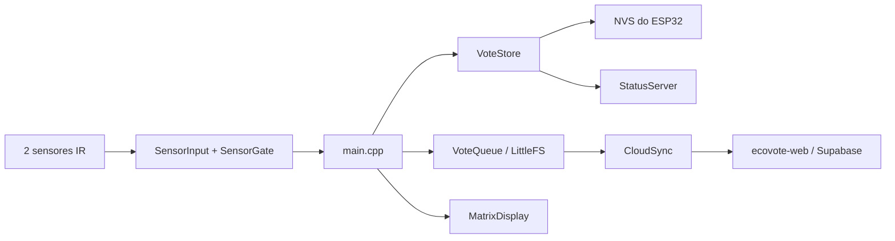

# EcoVote ESP32

Firmware C++ para **ESP32 DevKit** com dois sensores infravermelhos digitais e
matriz de LEDs **8×32 formada por quatro módulos MAX7219 em cadeia**. Cada
passagem confirmada soma um voto independente para o duto A ou B. O placar é
salvo na NVS do ESP32, enviado ao backend web e oferecido por HTTP na rede local.

**Interface web usada:** [ecovotedev/ecovote-web](https://github.com/ecovotedev/ecovote-web)
(`origin` do checkout analisado, commit
[`8bd98ec`](https://github.com/ecovotedev/ecovote-web/commit/8bd98ec0d75dbee631f8c513872dba34b8c2eeca)).
O backend é uma aplicação Next.js que grava
os votos no Supabase. O ESP32 se comunica com as rotas HTTPS `/api/hardware`;
o dashboard obtém os votos do banco de dados. O endereço padrão do backend é
`https://ecovote-web.vercel.app/api/hardware`, conforme o README desse repo.
Na versão analisada, as rotas web já recebem o formato de voto esperado; a
mudança necessária era no firmware, que antes oferecia apenas leitura local.

## Arquitetura do firmware

O arquivo `main.cpp` coordena os módulos. Ele inicializa os dois meios de
armazenamento, a matriz e os sensores e, a cada volta do `loop()`, verifica
passagens válidas. Para cada voto, atualiza a contagem, confirma na matriz,
grava um evento na fila offline e salva o contador. A API local consulta uma
cópia da contagem; outra tarefa envia a fila ao backend web.



| Arquivo | Responsabilidade |
| --- | --- |
| [`src/main.cpp`](src/main.cpp) | Coordena o ciclo de votação e configura o watchdog. Não contém código de protocolo, desenho ou filtragem. |
| [`include/sensor_gate.h`](include/sensor_gate.h) | Máquina de estados de um sensor: confirma uma obstrução de 40 ms e só rearma depois de 150 ms livre. Não depende do ESP32. |
| [`src/sensor_input.cpp`](src/sensor_input.cpp) / [`include/sensor_input.h`](include/sensor_input.h) | Liga GPIO 26/27 às interrupções, captura as bordas e aplica uma instância de `SensorGate` por duto. As interrupções apenas marcam eventos. |
| [`src/vote_store.cpp`](src/vote_store.cpp) / [`include/vote_store.h`](include/vote_store.h) | Mantém os totais A/B e o número de sequência; oferece uma cópia protegida para a API e grava o estado na NVS. |
| [`src/vote_queue.cpp`](src/vote_queue.cpp) / [`include/vote_queue.h`](include/vote_queue.h) | Grava cada voto em log LittleFS, recupera eventos após reinício e só confirma a remoção após a resposta do backend. |
| [`src/matrix_display.cpp`](src/matrix_display.cpp) / [`include/matrix_display.h`](include/matrix_display.h) | Inicializa os quatro MAX7219 por SPI, desenha caracteres, alterna os totais e mostra o feedback após cada voto. |
| [`src/status_server.cpp`](src/status_server.cpp) / [`include/status_server.h`](include/status_server.h) | Abre o ponto de acesso e a conexão à rede local, mantém o servidor HTTP e responde ao endpoint JSON. Roda em uma tarefa FreeRTOS própria. |
| [`src/cloud_sync.cpp`](src/cloud_sync.cpp) / [`include/cloud_sync.h`](include/cloud_sync.h) | Consulta a campanha ativa, obtém hora UTC por NTP, envia telemetria e lotes de votos por HTTPS em tarefa própria. |
| [`include/config.h`](include/config.h) | Define pinos, polaridade dos sensores e valores padrão de Wi-Fi. |
| [`include/wifi_secrets.h.example`](include/wifi_secrets.h.example) | Modelo para credenciais locais, que ficam fora do Git. |
| [`test/sensor_gate.cpp`](test/sensor_gate.cpp) | Verifica rejeição de ruído, bloqueio de votos repetidos e independência dos dutos sem exigir placa. |
| [`platformio.ini`](platformio.ini) | Seleciona ESP32 DevKit, framework Arduino, LittleFS e velocidade do monitor serial. |

**Fluxo de um voto:** a borda do IR acorda a validação; o sinal precisa
permanecer ativo por 40 ms; `VoteStore::record()` incrementa apenas o duto
correspondente; `MatrixDisplay::showVote()` mostra a confirmação;
`VoteQueue::append()` registra o evento para envio futuro; `VoteStore::save()`
grava os totais. O sensor só aceita outro objeto após 150 ms sem obstrução.
`StatusServer` consulta `VoteStore::snapshot()` sem acessar os pinos nem a
matriz. `CloudSync` envia somente eventos cujo contador já foi salvo.

A NVS usa dois registros alternados (`slot0` e `slot1`) com soma de
verificação. Na inicialização, o firmware escolhe o registro válido mais
recente. Uma interrupção de energia durante a gravação pode perder o último
voto ainda não confirmado na NVS, mas o registro anterior permanece legível.
O armazenamento é feito a cada voto; isso simplifica a recuperação, porém
implica desgaste da flash em instalações de votação muito intensa. O log
LittleFS só é apagado quando todos os seus votos foram confirmados pelo backend.

## Ligações

| Componente | Sinal | GPIO ESP32 |
| --- | --- | --- |
| Sensor IR A | OUT | 26 |
| Sensor IR B | OUT | 27 |
| MAX7219 | DIN | 23 |
| MAX7219 | CLK | 18 |
| MAX7219 | CS/LOAD | 5 |

Use GND comum. Alimente a matriz com uma fonte de 5 V adequada para **quatro
módulos**, sem puxar a corrente da matriz pelo pino 3V3. As entradas do ESP32
aceitam **no máximo 3,3 V**: se o OUT dos sensores alimentados em 5 V puder
subir a 5 V, use divisor de tensão ou conversor de nível em cada OUT. Se a
matriz não reconhecer de forma confiável sinais de 3,3 V, use conversor de
nível também em DIN, CLK e CS. Confira a corrente e a polaridade do módulo
específico antes de ligar. O desenho da matriz presume o encadeamento e a
orientação comuns de módulos MAX7219; outra montagem pode exigir ajuste em
`drawText`.

Os sensores do documento de arquitetura usam GPIO 26 e 27 e normalmente
acionam em nível baixo. Mude `ECOVOTE_SENSOR_ACTIVE_LEVEL` em
[`include/config.h`](include/config.h) se seu sensor acionar em nível alto.

## Gravação

1. Instale [PlatformIO](https://platformio.org/) e abra este diretório.
2. Copie [`include/wifi_secrets.h.example`](include/wifi_secrets.h.example) para
   `include/wifi_secrets.h`. Preencha o SSID e a senha Wi-Fi de 2,4 GHz,
   `ECOVOTE_DEVICE_API_KEY` com o mesmo valor de `DEVICE_API_KEY` do backend e
   `ECOVOTE_BACKEND_CA_CERT` com o certificado CA raiz em PEM. O arquivo de
   credenciais é ignorado pelo Git. Para um teste local sem CA, defina
   `ECOVOTE_ALLOW_INSECURE_TLS 1`; isso desativa a verificação do servidor e
   não deve ser usado na instalação final. Sem SSID, o ESP32 mantém apenas o
   próprio ponto de acesso e não consegue enviar votos ao backend. Troque a
   senha padrão do AP.
3. Na primeira gravação, execute `pio run -t uploadfs` para inicializar a
   partição LittleFS da fila de votos. **Não repita esse comando depois de
   começar a votar:** ele substitui o conteúdo da partição e apaga a fila.
4. Execute `pio run -t upload` e abra o monitor com `pio device monitor`.
5. No painel web, cadastre o dispositivo pelo MAC mostrado pelo ESP32 e ative
   uma campanha para ele. O backend retorna `404` em `/active` e `/ping` até
   o cadastro existir.

O ponto de acesso chama-se `EcoVote-<últimos 6 dígitos do MAC>` e usa
`192.168.4.1`. Com a rede local configurada, o mesmo endpoint também fica
disponível no IP atribuído ao ESP32; o monitor serial mostra o IP do AP.

## Envio para `ecovote-web`

O firmware segue o contrato encontrado em
[`ecovote-web/src/app/api/hardware`](https://github.com/ecovotedev/ecovote-web/tree/main/src/app/api/hardware):

| Requisição feita pelo ESP32 | Quando | Dados principais |
| --- | --- | --- |
| `GET /active?mac_address=<MAC>` | Ao conectar e a cada 60 s | Obtém o `campaign_id` da campanha ativa e o guarda na NVS. |
| `POST /ping` | Ao conectar e a cada 5 min | Envia MAC, IP local e potência do sinal Wi-Fi. |
| `POST /sync` | Há votos na fila; tenta a cada 3 s | Envia até 20 votos por lote com `campaign_id`, opção A/B e horário UTC. |

Todas as requisições usam `x-device-api-key` e HTTPS. O MAC é enviado com
dois-pontos, no formato exigido pelo backend (`AA:BB:CC:DD:EE:FF`). Após um
`HTTP 200` com `success: true` em `/sync`, a fila avança o cursor de votos
confirmados. Em falhas de rede ou resposta diferente, mantém os eventos para
nova tentativa. O backend grava votos individuais no Supabase; assim, o
dashboard se atualiza sem precisar acessar o IP local do ESP32.

Se um voto ocorrer sem hora NTP válida, o evento guarda o horário como
desconhecido e recebe o horário da reconexão quando for enviado. Se ainda não
houver campanha conhecida, ele aguarda `/active`; após uma troca de campanha
durante uma desconexão, eventos sem campanha podem ser atribuídos à campanha
encontrada na reconexão. Para preservar a campanha correta, mantenha o ESP32
conectado quando ativar ou encerrar uma votação.

O placar local e o endpoint de diagnóstico mostram a contagem acumulada deste
ESP32. O dashboard web separa os votos por campanha. Uma reinicialização dos
totais locais na troca de campanha ainda exigiria um comando de ciclo de
votação acordado entre firmware e backend.

**Limite do backend atual:** `/sync` não recebe um identificador único por
voto. Se o servidor gravar um lote mas a resposta se perder, a tentativa
seguinte pode duplicar esse lote. A deduplicação exigirá uma alteração futura
no repositório web (por exemplo, `device_id + sequence` com índice único).

## Endpoint local de diagnóstico

O endpoint abaixo permite consultar o ESP32 diretamente na mesma rede. O
dashboard `ecovote-web` não o consome; usa os votos gravados no Supabase.

`GET http://<ip-do-esp32>/api/v1/status` devolve, por exemplo:

```json
{
  "deviceId": "AABBCCDDEEFF",
  "votesA": 12,
  "votesB": 8,
  "total": 20,
  "sequence": 20,
  "wifiConnected": true,
  "ip": "192.168.1.25",
  "apIp": "192.168.4.1",
  "rssi": -58,
  "uptimeMs": 123456
}
```

O endpoint é somente leitura. `sequence` cresce a cada voto e permite perceber
mudanças; `deviceId` identifica a lixeira. Para testar na rede local:

```js
const response = await fetch("http://192.168.1.25/api/v1/status", {
  cache: "no-store",
});
if (!response.ok) throw new Error(`ESP32: HTTP ${response.status}`);
const { deviceId, votesA, votesB, sequence } = await response.json();
```

O firmware envia cabeçalhos CORS para consulta em rede local. Páginas HTTPS
podem ter acesso HTTP local bloqueado pelo navegador; o envio principal ao
backend usa HTTPS e independe dessa consulta.

## Comportamento

- Um pulso precisa permanecer ativo por 40 ms para virar voto.
- Após um voto, o sensor precisa ficar inativo por 150 ms para aceitar outro.
- A matriz mostra `A0 B0` enquanto ambos os totais têm um dígito. Para
  números maiores, alterna `A:<total>` e `B:<total>`; números longos rolam na
  tela. Após um voto, mostra imediatamente a opção acionada por 1,2 s.
- A API roda em tarefa separada do laço de sensores. Os totais são gravados
  alternadamente em dois registros NVS com verificação de integridade.

A matriz de 8 pixels de altura permite uma linha de texto. Por isso a pergunta
configurável descrita para o OLED na documentação não cabe junto ao placar;
as opções/pergunta devem ser sinalizadas fisicamente e exibidas na interface
web. Teste com resíduos reais: temporização e proteção contra luz ambiente
dependem da posição e do modelo dos sensores.

## Verificação local

O teste de filtragem independente de hardware pode ser executado com:

```sh
g++ -std=c++17 -Iinclude test/sensor_gate.cpp -o /tmp/ecovote-sensor-test
/tmp/ecovote-sensor-test
```

O build e os testes elétricos exigem PlatformIO, placa e matriz conectadas.
