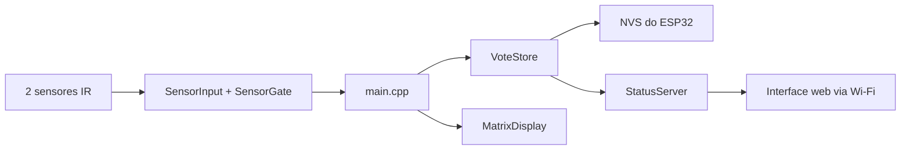

# EcoVote ESP32

Firmware C++ para **ESP32 DevKit** com dois sensores infravermelhos digitais e
matriz de LEDs **8×32 formada por quatro módulos MAX7219 em cadeia**. Cada
passagem confirmada soma um voto independente para o duto A ou B. O placar é
salvo na NVS do ESP32 e oferecido por HTTP na rede Wi-Fi.

## Arquitetura do firmware

O arquivo `main.cpp` coordena os módulos. Ele inicializa o armazenamento, a
matriz e os sensores e, a cada volta do `loop()`, pergunta se houve uma
passagem válida. Para cada voto, atualiza a contagem, confirma na matriz e
salva o novo estado. A API consulta uma cópia da contagem em outra tarefa.



| Arquivo | Responsabilidade |
| --- | --- |
| [`src/main.cpp`](src/main.cpp) | Coordena o ciclo de votação e configura o watchdog. Não contém código de protocolo, desenho ou filtragem. |
| [`include/sensor_gate.h`](include/sensor_gate.h) | Máquina de estados de um sensor: confirma uma obstrução de 40 ms e só rearma depois de 150 ms livre. Não depende do ESP32. |
| [`src/sensor_input.cpp`](src/sensor_input.cpp) / [`include/sensor_input.h`](include/sensor_input.h) | Liga GPIO 26/27 às interrupções, captura as bordas e aplica uma instância de `SensorGate` por duto. As interrupções apenas marcam eventos. |
| [`src/vote_store.cpp`](src/vote_store.cpp) / [`include/vote_store.h`](include/vote_store.h) | Mantém os totais A/B e o número de sequência; oferece uma cópia protegida para a API e grava o estado na NVS. |
| [`src/matrix_display.cpp`](src/matrix_display.cpp) / [`include/matrix_display.h`](include/matrix_display.h) | Inicializa os quatro MAX7219 por SPI, desenha caracteres, alterna os totais e mostra o feedback após cada voto. |
| [`src/status_server.cpp`](src/status_server.cpp) / [`include/status_server.h`](include/status_server.h) | Abre o ponto de acesso e a conexão à rede local, mantém o servidor HTTP e responde ao endpoint JSON. Roda em uma tarefa FreeRTOS própria. |
| [`include/config.h`](include/config.h) | Define pinos, polaridade dos sensores e valores padrão de Wi-Fi. |
| [`include/wifi_secrets.h.example`](include/wifi_secrets.h.example) | Modelo para credenciais locais, que ficam fora do Git. |
| [`test/sensor_gate.cpp`](test/sensor_gate.cpp) | Verifica rejeição de ruído, bloqueio de votos repetidos e independência dos dutos sem exigir placa. |
| [`platformio.ini`](platformio.ini) | Seleciona a placa ESP32 DevKit, o framework Arduino e a velocidade do monitor serial. |

**Fluxo de um voto:** a borda do IR acorda a validação; o sinal precisa
permanecer ativo por 40 ms; `VoteStore::record()` incrementa apenas o duto
correspondente; `MatrixDisplay::showVote()` mostra a confirmação;
`VoteStore::save()` grava os totais. O sensor só aceita outro objeto após
150 ms sem obstrução. Durante esse processo, `StatusServer` pode consultar
`VoteStore::snapshot()` sem acessar os pinos nem a matriz.

A NVS usa dois registros alternados (`slot0` e `slot1`) com soma de
verificação. Na inicialização, o firmware escolhe o registro válido mais
recente. Uma interrupção de energia durante a gravação pode perder o último
voto ainda não confirmado na NVS, mas o registro anterior permanece legível.
O armazenamento é feito a cada voto; isso simplifica a recuperação, porém
implica desgaste da flash em instalações de votação muito intensa.

## Ligações

| Componente | Sinal | GPIO ESP32 |
| --- | --- | --- |
| Sensor IR A | OUT | 26 |
| Sensor IR B | OUT | 27 |
| MAX7219 | DIN | 23 |
| MAX7219 | CLK | 18 |
| MAX7219 | CS/LOAD | 5 |

Use GND comum. Alimente a matriz com uma fonte de 5 V adequada para **quatro
módulos**, sem puxar a corrente da matriz pelo pino 3V3. As entradas do ESP32
aceitam **no máximo 3,3 V**: se o OUT dos sensores alimentados em 5 V puder
subir a 5 V, use divisor de tensão ou conversor de nível em cada OUT. Se a
matriz não reconhecer de forma confiável sinais de 3,3 V, use conversor de
nível também em DIN, CLK e CS. Confira a corrente e a polaridade do módulo
específico antes de ligar. O desenho da matriz presume o encadeamento e a
orientação comuns de módulos MAX7219; outra montagem pode exigir ajuste em
`drawText`.

Os sensores do documento de arquitetura usam GPIO 26 e 27 e normalmente
acionam em nível baixo. Mude `ECOVOTE_SENSOR_ACTIVE_LEVEL` em
[`include/config.h`](include/config.h) se seu sensor acionar em nível alto.

## Gravação

1. Instale [PlatformIO](https://platformio.org/) e abra este diretório.
2. Copie [`include/wifi_secrets.h.example`](include/wifi_secrets.h.example) para
   `include/wifi_secrets.h` e preencha os dados da rede. Este arquivo local é
   ignorado pelo Git. Sem SSID, o ESP32 opera pelo próprio ponto de acesso.
   Troque `ECOVOTE_AP_PASSWORD` antes de usar fora da bancada.
3. Execute `pio run -t upload` e abra o monitor com `pio device monitor`.

O ponto de acesso chama-se `EcoVote-<últimos 6 dígitos do MAC>` e usa
`192.168.4.1`. Com a rede local configurada, o mesmo endpoint também fica
disponível no IP atribuído ao ESP32; o monitor serial mostra o IP do AP.

## API para `ecovote-web`

`GET http://<ip-do-esp32>/api/v1/status` devolve, por exemplo:

```json
{
  "deviceId": "AABBCCDDEEFF",
  "votesA": 12,
  "votesB": 8,
  "total": 20,
  "sequence": 20,
  "wifiConnected": true,
  "ip": "192.168.1.25",
  "apIp": "192.168.4.1",
  "rssi": -58,
  "uptimeMs": 123456
}
```

O endpoint é somente leitura. `sequence` cresce a cada voto e permite ao
consumidor perceber mudanças; `deviceId` identifica a lixeira. Faça polling
por exemplo a cada segundo:

```js
const response = await fetch("http://192.168.1.25/api/v1/status", {
  cache: "no-store",
});
if (!response.ok) throw new Error(`ESP32: HTTP ${response.status}`);
const { deviceId, votesA, votesB, sequence } = await response.json();
```

O firmware envia cabeçalhos CORS para permitir
acesso a partir de outra origem. A interface precisa estar na mesma rede, ou
usar uma ponte no servidor. Uma página HTTPS publicada na internet pode ter a
requisição HTTP local bloqueada pelo navegador; nesse caso, o servidor da
interface deve consultar o ESP32 pela rede local e expor os dados via HTTPS.

O repositório `ecovote-web` não estava acessível neste ambiente, então não foi
possível confirmar suas rotas, campos ou fluxo de integração. Este contrato
HTTP é o ponto de ligação a implementar na interface. O endpoint não envia
votos automaticamente a um servidor remoto: o consumidor deve buscar o total
persistido ao reconectar e deduplicar por `deviceId` e `sequence`.

## Comportamento

- Um pulso precisa permanecer ativo por 40 ms para virar voto.
- Após um voto, o sensor precisa ficar inativo por 150 ms para aceitar outro.
- A matriz mostra `A0 B0` enquanto ambos os totais têm um dígito. Para
  números maiores, alterna `A:<total>` e `B:<total>`; números longos rolam na
  tela. Após um voto, mostra imediatamente a opção acionada por 1,2 s.
- A API roda em tarefa separada do laço de sensores. Os totais são gravados
  alternadamente em dois registros NVS com verificação de integridade.

A matriz de 8 pixels de altura permite uma linha de texto. Por isso a pergunta
configurável descrita para o OLED na documentação não cabe junto ao placar;
as opções/pergunta devem ser sinalizadas fisicamente e exibidas na interface
web. Teste com resíduos reais: temporização e proteção contra luz ambiente
dependem da posição e do modelo dos sensores.

## Verificação local

O teste de filtragem independente de hardware pode ser executado com:

```sh
g++ -std=c++17 -Iinclude test/sensor_gate.cpp -o /tmp/ecovote-sensor-test
/tmp/ecovote-sensor-test
```

O build e os testes elétricos exigem PlatformIO, placa e matriz conectadas.
